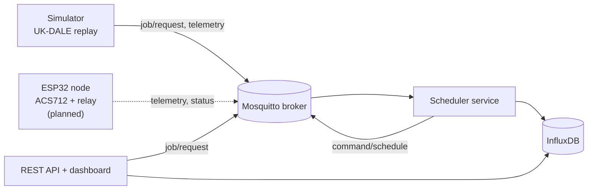

# Edge-Cloud IoT Platform for Real-Time, Cost- and Peak-Aware Scheduling of Flexible Residential Appliances

Course capstone for **AST01.41 Fundamentals of Internet of Things and Cloud Computing**.
Authors: Subhana Chitrakar, Prasiddha Kansakar.

Flexible household appliances (washing machines, dishwashers, water heaters) can shift their operation in time to lower electricity cost and reduce aggregate peak demand. This project builds an edge-cloud IoT platform around that idea:

- A **containerized cloud platform** (MQTT broker, scheduling service, time-series database, REST API, web dashboard) that schedules appliance jobs for a simulated neighborhood driven by real UK-DALE load traces.
- A **physical ESP32 node** (ACS712 current sensor + relay) that measures a real appliance and keeps enforcing safety and deadline rules locally, even when MQTT connectivity is lost. *(Hardware phase: see [Project status](#project-status).)*

Three strategies are compared on electricity cost, peak demand, and deadline-miss rate: no scheduling, fixed off-peak, and a dynamic cost/peak-aware scheduler.

---

## Contents

1. [Project status](#project-status)
2. [Architecture](#architecture)
3. [Results so far](#results-so-far)
4. [Getting started](#getting-started)
5. [Using the system](#using-the-system)
6. [Interface contracts](#interface-contracts)
7. [Security model](#security-model)
8. [Assumptions](#assumptions)
9. [Repository layout](#repository-layout)
10. [Development workflow](#development-workflow)
11. [Troubleshooting](#troubleshooting)
12. [Known limitations](#known-limitations)
13. [References](#references)

---

## Project status

| Area | Status |
|---|---|
| UK-DALE processing: 1-minute series and job extraction | Done |
| Scheduling strategies (5 variants) and offline evaluation at 5/10/15/20 households | Done |
| Online scheduler equals batch scheduler (unit-tested) | Done |
| Dockerized stack: Mosquitto, InfluxDB, scheduler, simulator, API | Done |
| MQTT simulator with lock-step handshake | Done |
| Broker authentication and per-client ACLs (verified by `scripts/test_acl.py`) | Done |
| REST API and web dashboard | Done |
| MQTT pipeline reproduces offline results at 20 households, seed 0 | **To verify** |
| ESP32 firmware (telemetry, status with last will, schedule handling) | Pending |
| Edge safety/deadline rule engine and offline buffer | Pending |
| ACS712 calibration, relay wiring, real-appliance demo | Pending |
| Network-interruption test (cut MQTT mid-run, confirm local enforcement) | Pending |
| `LAMBDA` sweep and mean/std across seeds | Pending |
| Scale experiments (5/10/15/20 households) through MQTT | Pending |
| Final paper | Pending |

---

## Architecture

The system follows the four-layer design from the interim paper, mapped onto the Industry IoT Consortium's reference architecture (IIRA): the perception and edge layers form the Edge tier, and the cloud and application layers form the Platform tier.



| Layer | Components |
|---|---|
| Perception | ACS712 current sensor, relay, demo appliance *(planned)* |
| Edge | ESP32 firmware: safety/deadline rule engine, store-and-forward buffer *(planned)* |
| Cloud | Mosquitto broker, scheduler service, InfluxDB, simulator (all in Docker) |
| Application | FastAPI REST API and a static web dashboard served by the same container |

**Design principle:** time-critical local control stays on the edge device, while neighborhood-level optimization runs in the cloud. The cloud can be slow or unreachable without the appliance misbehaving.

### Data flow (simulation)

1. The simulator builds N households from real UK-DALE jobs and publishes each job as a `job/request` at its release time.
2. The scheduler subscribes, picks a start time with the active strategy, replies on `command/schedule`, and writes the decision to InfluxDB.
3. The simulator waits for every reply before advancing its clock (lock-step), so runs are deterministic even at maximum speed.
4. The API reads decisions from InfluxDB, computes cost, peak, and miss rate per run, and the dashboard plots them.

### Scheduling strategies

| Strategy | Behavior |
|---|---|
| `no_scheduling` | Start when the user requested the job. |
| `fixed_offpeak` | An off-peak timer: wait for 22:00. Ignores deadlines, so it can miss them. |
| `fixed_offpeak_safe` | Same timer, but falls back to "start now" if waiting would miss the deadline. This is the fair baseline. |
| `cost_only` | Cheapest feasible start. Ablation showing the pile-up problem (everything lands at the cheapest hour). |
| `dynamic` | For each job (in request order), scores every feasible start in 15-minute steps as `energy cost + LAMBDA x (kW x already-scheduled load over the job's window)`. The second term spreads jobs out. |

The batch evaluator and the online MQTT service share one implementation (`place_job` in `scheduler/strategies.py`), and `tests/test_online.py` proves they make identical decisions.

---

## Results so far

Offline evaluation (`eval/run_eval.py`), 20 households, mean of 10 seeds. Source: UK-DALE flexible appliances, flexible loads only. Cost is in currency units under the assumed tariff.

| Strategy | Cost | Peak (kW) | Deadline-miss rate |
|---|---|---|---|
| no_scheduling | 33.88 | 6.72 | 0% |
| fixed_offpeak_safe | 26.16 | 11.73 | 0% |
| cost_only | 25.39 | 12.21 | 0% |
| **dynamic** | **25.40** | **4.21** | **0%** |
| fixed_offpeak (deadline-blind) | 17.28 | 19.62 | 53% |

Reading the table:

- **Dynamic vs. no scheduling:** about 25% cheaper and 37% lower peak.
- **Dynamic vs. the fair timer (`fixed_offpeak_safe`):** about 3% cheaper and 64% lower peak. The main contribution is peak reduction at essentially no cost penalty.
- **Cost-only and the timers** pile jobs into the cheapest window and create a new, larger peak. The peak-aware term avoids this.
- **`fixed_offpeak` looks cheapest only because it breaks deadlines.** Do not read it as beating the others.
- The ranking is the same at 5, 10, 15, and 20 households. Full numbers are in `eval/results/summary.csv`.

Figures: `eval/results/summary.png` (cost, peak, miss rate vs. households) and `eval/results/load_curves.png` (load curve per strategy).

---

## Getting started

### Prerequisites

- Git
- **Python 3.12** (a 3.12 venv works even if 3.13 is installed system-wide)
- Docker Desktop (running)
- VS Code (recommended)

Commands below are PowerShell. On macOS/Linux, replace `copy` with `cp` and `.venv\Scripts\activate` with `source .venv/bin/activate`.

### 1. Clone and create the environment

```powershell
git clone <repo-url>
cd edge-cloud-appliance-scheduler
py -3.12 -m venv .venv
.venv\Scripts\activate
python --version                      # must say 3.12.x
python -m pip install --upgrade pip
pip install -r requirements.txt
```

### 2. Get the data (optional)

`data/processed/jobs.csv` is committed, so you can skip this step. To regenerate it, download UK-DALE as per-house folders of `.dat` files (see `data/README.md`) so the layout is:

```
data/raw/ukdale/house_1/labels.dat
data/raw/ukdale/house_1/channel_5.dat
...
```
then run:
```powershell
python data/process_data.py
```
The raw dataset (several GB) is gitignored and must never be committed.

### 3. Run the offline evaluation

```powershell
python -m pytest
python eval/run_eval.py
```
`pytest` is limited to `tests/` via `pytest.ini`. `run_eval.py` writes `eval/results/results.csv`, `summary.csv`, `summary.png`, and `load_curves.png`.

### 4. Configure the environment

```powershell
copy .env.example .env
```
Edit `.env`:

- `INFLUXDB_PASSWORD`: at least 8 characters, using letters, digits, `-` and `_` only.
- `INFLUXDB_TOKEN`: generate with `python -c "import secrets; print(secrets.token_hex(24))"`.
- `API_KEY`: generate with `python -c "import secrets; print(secrets.token_hex(16))"`.
- Leave the `MQTT_*_PASSWORD=` lines empty. The next step fills them in.

`.env` is gitignored. Each teammate keeps their own, and the values do not need to match.

### 5. Create the broker users (before the first `docker compose up`)

```powershell
python scripts/make_mqtt_users.py
```
This generates a random password for each MQTT client, writes the hashed `broker/passwd` (gitignored), and fills the empty password lines in `.env`.

> Run this **before** starting Docker. If `broker/passwd` does not exist when the stack starts, Docker creates a *folder* with that name and the broker crash-loops.

### 6. Start the stack

```powershell
docker compose up -d --build
docker compose ps
```
Expect `iot-broker`, `iot-tsdb`, `iot-scheduler`, and `iot-api` to be Up. Whenever `.env` changes, use `docker compose up -d --force-recreate` (a plain `restart` keeps the old environment).

### 7. Verify the stack

```powershell
python scripts/smoke_test.py          # MQTT round trip and InfluxDB write/read
python scripts/test_acl.py            # broker authentication and ACL checks (6 PASS lines)
```

---

## Using the system

### Run a simulation

```powershell
# Quick run: 5 households, scheduler's current strategy (default: dynamic)
docker compose run --rm -e N_HOUSEHOLDS=5 simulator

# One strategy at 20 households, with an explicit run id
docker compose run --rm -e N_HOUSEHOLDS=20 -e SEED=0 -e SIM_STRATEGY=dynamic -e RUN_ID=dynamic-n20-seed0 simulator
```

Compare all strategies at 20 households, seed 0:
```powershell
foreach ($s in "no_scheduling","fixed_offpeak_safe","cost_only","dynamic") {
  docker compose run --rm -e N_HOUSEHOLDS=20 -e SEED=0 -e SIM_STRATEGY=$s -e RUN_ID="$s-n20-seed0" simulator
}
```
Then compare the dashboard table with the offline numbers:
```powershell
python -c "import pandas as pd; d=pd.read_csv('eval/results/results.csv'); print(d[(d.n_households==20)&(d.seed==0)][['strategy','cost','peak_kw','miss_rate']])"
```
Cost, peak, and miss rate should agree up to small rounding. The payload rounds `kw` to 4 decimals.

Simulator options (environment variables): `N_HOUSEHOLDS`, `SEED`, `SIM_STRATEGY`, `RUN_ID`, `SIM_SPEED` (simulated minutes per real second; `0` = maximum speed), `TELEMETRY_STEP_MIN`.

### Dashboard and API

| URL | What |
|---|---|
| http://localhost:8000 | Dashboard: strategy comparison table, overlaid aggregate load curves, per-household load, recent decisions, physical-node panel, schedule request form |
| http://localhost:8000/docs | Auto-generated API documentation |
| http://localhost:8086 | InfluxDB UI (log in with the credentials from `.env`) |

Tick runs in the comparison table to overlay them on the load chart.

### Request a schedule through the API

```powershell
$key = (Select-String -Path .env -Pattern '^API_KEY=').Line.Split('=')[1]
$body = @{ house_id="H01"; device_id="water_heater_01"; requested_by="user";
           release="2026-10-19T09:00:00+07:00"; deadline="2026-10-20T07:00:00+07:00";
           duration_minutes=45; priority="normal" } | ConvertTo-Json
Invoke-RestMethod -Method Post -Uri http://localhost:8000/api/v1/schedule `
  -Headers @{ "X-API-Key" = $key } -ContentType "application/json" -Body $body
```
Expected: a `scheduled_start` inside the 22:00-06:00 window and `estimated_cost` about 0.075 (1 kW for 0.75 h at 0.10). A wrong key returns `401`, and a `deadline` without a UTC offset returns `422`. Do not POST while a simulation is running, because the live job would add load to that run's scheduler state.

### Watch MQTT traffic

```powershell
docker compose exec broker mosquitto_sub -u admin -P <MQTT_ADMIN_PASSWORD> -t "sim/S01/#" -v
```

### Live demo timing

The scheduler's timeline starts at `EPOCH` (default `2026-10-19T00:00:00+07:00`, a Monday) and covers 9 days. For a live demo with the physical node, set `EPOCH` in `.env` to local midnight on demo day and recreate the scheduler, simulator, and API with `--force-recreate`. Results do not change because the tariff depends only on the hour of day. Use new run ids afterward, or wipe the data with `docker compose down -v`.

---

## Interface contracts

### MQTT topics

`{root}` is `sim` for simulated households and `home` for the physical node. All timestamps are ISO-8601 **with a UTC offset**.

| Topic | Direction | QoS | Retained | Payload |
|---|---|---|---|---|
| `{root}/{house}/device/{dev}/job/request` | device or simulator -> scheduler | 1 | no | `{job_id, ts, release, duration_min, kw, deadline, priority}` |
| `{root}/{house}/device/{dev}/command/schedule` | scheduler -> device | 1 | `home`: yes, `sim`: no | `{job_id, schedule_id, status, start, end, estimated_cost, estimated_peak_contribution_kw, planned_aggregate_peak_kw}` or `{job_id, status: "rejected", reason}` |
| `{root}/{house}/device/{dev}/telemetry/power` | -> scheduler | sim 0, home 1 | no | `{ts, watts}` |
| `home/{house}/device/{dev}/status` | ESP32 -> cloud | 1 | yes | `{online, safety_state, ts}`; last will `{online: false}` *(planned)* |
| `home/{house}/device/{dev}/command/override` | cloud -> ESP32 | 2 | no | manual override *(planned)* |
| `neighborhood/{id}/aggregate/demand` | scheduler-internal | 0 | no | `{ts, planned_peak_kw, jobs_scheduled, strategy}` |
| `control/reset`, `control/ack` | simulator <-> scheduler | 1 | no | `{run_id, strategy?}` |

The physical node's schedule is retained so it receives its last-known-good schedule immediately after reconnecting. Topic names live in one place, `common/topics.py`.

### REST API (`/api/v1`)

| Method | Path | Auth | Purpose |
|---|---|---|---|
| GET | `/health` | none | MQTT and InfluxDB connectivity |
| GET | `/runs` | none | Metrics per run: cost, peak, miss rate, average delay |
| GET | `/runs/{run_id}/load?step=15` | none | Aggregate and per-household load curves |
| GET | `/runs/{run_id}/decisions?limit=50` | none | Recent scheduling decisions |
| GET | `/devices` | none | Device status and last schedule (cached from MQTT) |
| GET | `/live/{house}/{device}?minutes=30` | none | Recent real power readings |
| POST | `/schedule` | `X-API-Key` | Request a schedule |

`POST /schedule` request body:

```json
{
  "house_id": "H01",
  "device_id": "water_heater_01",
  "requested_by": "user",
  "deadline": "2026-10-20T07:00:00+07:00",
  "duration_minutes": 45,
  "priority": "normal"
}
```
Optional fields: `release` (defaults to now), `kw` (defaults to a per-device value), `source` (`home` or `sim`). `priority: "urgent"` means zero slack (the job starts immediately).

Response `200`:
```json
{
  "schedule_id": "S00001",
  "device_id": "water_heater_01",
  "scheduled_start": "2026-10-19T22:00:00+07:00",
  "scheduled_end": "2026-10-19T22:45:00+07:00",
  "estimated_cost": 0.075,
  "estimated_peak_contribution_kw": 1.0
}
```

### InfluxDB data model

| Measurement | Tags | Fields |
|---|---|---|
| `schedule_decision` | `root, house, device, run_id, strategy` | `job_id, schedule_id, delay_min, duration_min, kw, cost, deadline_met` |
| `neighborhood` | `neighborhood, run_id, strategy` | `planned_peak_kw, jobs_scheduled` |
| `power` | `root, house, device, run_id` | `watts` |

Data is stamped with **simulated** time, so queries need a wide custom time range rather than "Past 1h".

---

## Security model

| Boundary | Mechanism |
|---|---|
| MQTT authentication | Anonymous access disabled. Every client has its own username and password (hashed in `broker/passwd`, gitignored). |
| MQTT authorization | Per-client ACLs in `broker/acl`. The physical node can publish only under its own `home/H01/device/water_heater_01/...` topics and read only its own commands. The scheduler, simulator, and API each get the narrowest set they need. |
| REST | Read-only views are open. `POST /schedule` requires an `X-API-Key` header (constant-time comparison). Inputs are validated with Pydantic, and identifiers are checked against a strict pattern before use in queries. |
| Service boundaries | Only the scheduler writes decisions to InfluxDB. The API is read-mostly and forwards validated writes as MQTT job requests. |
| Secrets | `.env` and `broker/passwd` are gitignored. `.env.example` holds placeholders only. |

`scripts/test_acl.py` verifies six properties: anonymous login is refused, a wrong password is refused, device login works, a device can publish to its own topic, a device cannot publish to another house's topic, and a device cannot subscribe to another house's commands.

Mosquitto prints warnings about the password and ACL file ownership and permissions. This is expected when Windows mounts files into the container. In a production deployment those files would be owned by the broker user with mode `0700`.

---

## Assumptions

These are all modeling choices, so state them in the paper.

| Item | Value |
|---|---|
| Dataset | UK-DALE appliance-level channels (washing machine, dishwasher), resampled to 1-minute means |
| Job detection | Appliance above 10 W for at least 10 minutes; pauses up to 5 minutes are merged into one job |
| Job power profile | Rectangular (average kW over the job) |
| Households | Source house plus a random 7-day window, shifted to start at minute 0; per-household seeded RNG so household *k* is identical at any N |
| Deadlines | `release + duration + slack`, slack ~ Uniform(1, 12) hours (not in the datasets) |
| Tariff (assumed) | Off-peak 22:00-06:00 at 0.10 per kWh; peak 17:00-21:00 at 0.35; shoulder 0.20 |
| Dynamic scheduler | 15-minute candidate starts; `LAMBDA = 0.02`; jobs placed greedily in request order |
| Horizon | 7 days plus a 2-day buffer for jobs that finish late |
| Time | Scheduler minute 0 = `EPOCH` (local midnight); the tariff is computed on local hours |
| Peak demand | Computed over flexible loads only; baseline load (lights, fridge, etc.) is not included |

Config values live in `common/config.py`.

---

## Repository layout

```
.
├── README.md
├── docker-compose.yml        # broker, tsdb, scheduler, api, simulator (profile: sim)
├── pytest.ini                # restricts pytest to tests/
├── requirements.txt          # local dev environment
├── .env.example              # committed placeholders; real .env is gitignored
├── broker/
│   ├── mosquitto.conf
│   ├── acl                   # per-client topic permissions
│   └── passwd                # generated, gitignored
├── common/                   # shared config, tariff, topic names
├── data/
│   ├── process_data.py       # raw UK-DALE -> 1-minute series + jobs.csv
│   ├── processed/            # jobs.csv (committed), parquet series
│   └── raw/                  # gitignored
├── scheduler/                # strategies, online scheduler, MQTT service, Dockerfile
├── simulator/                # MQTT replay of simulated households, Dockerfile
├── api/                      # FastAPI app, InfluxDB reader, MQTT bridge, Dockerfile
├── dashboard/                # static web dashboard (Chart.js bundled locally)
├── eval/                     # household builder, run_eval.py, results/
├── scripts/                  # smoke_test.py, test_acl.py, make_mqtt_users.py
├── tests/                    # unit tests
├── notebooks/                # exploration
├── esp32/                    # firmware (planned)
└── docs/                     # paper, figures, notes
```

---

## Development workflow

- `main` always works. Each task gets a short-lived branch (`feature/...`) and a Pull Request that the teammate reviews.
- Pull before starting work: `git checkout main; git pull`. After a pull that changes `requirements.txt`, run `pip install -r requirements.txt`.
- Before every commit, run `git status` and confirm `.env`, `broker/passwd`, `.venv/`, and `data/raw/` are **not** listed.
- Tag deliverables, for example `git tag -a interim-v1 -m "Interim submission"`, then `git push origin interim-v1`.
- Run the tests with `python -m pytest` from the repo root, so the root is on the import path.
- Do not edit `jobs.csv` or the `process_data.py` settings without telling your teammate, since that changes everyone's results.

---

## Troubleshooting

| Symptom | Fix |
|---|---|
| Broker keeps restarting | `broker/passwd` is a folder. Stop the stack, delete the folder, run `python scripts/make_mqtt_users.py`, then start the stack again. |
| Scheduler or API log says "Not authorized" | The container was created while its password was empty. Run `docker compose up -d --force-recreate`. |
| Simulator: "scheduler did not acknowledge the reset" | The scheduler is not running or cannot log in. Check `docker compose logs scheduler`. |
| Simulator: "Could not subscribe" | Wrong password or ACL. Rerun `make_mqtt_users.py` and recreate the containers. |
| Simulator: "Timed out waiting for scheduler replies" | Rerun with `-e TELEMETRY_STEP_MIN=30` or `-e SIM_SPEED=200`. |
| InfluxDB 401 | The token in `.env` differs from the one the volume was created with. Run `docker compose down -v` and then `up -d` (this wipes stored data). |
| `/api/v1/runs` returns 502 | Run `docker compose logs api --tail 40` right after the request and read the traceback. |
| Dashboard table empty | No runs yet. Run the simulator, then wait about 10 seconds. |
| Charts blank | `dashboard/chart.umd.min.js` is missing. Re-download it and rebuild the API image. |
| Port 1883, 8086, or 8000 already in use | Stop the other program, or change the left side of the port mapping in `docker-compose.yml`. |
| `pytest` collects the scripts | Make sure `pytest.ini` exists in the repo root (`testpaths = tests`). |
| `COPY failed ... jobs.csv` during build | `data/processed/jobs.csv` is missing. Commit it or regenerate it with `process_data.py`. |

---

## Known limitations

- The scheduler's state (committed load) is in memory, so a restart loses it.
- Peak demand covers flexible loads only. Baseline household load is not modeled.
- Job power is a rectangular average, not the real appliance profile.
- Deadlines, the tariff, and the slack range are assumptions, not dataset values.
- The dashboard's load curves are planned load rebuilt from the scheduler's decisions at 15-minute resolution. Measured power comes only from the physical node.
- MQTT and HTTP run without TLS (localhost demo). A real deployment would add TLS.
- Only one physical node exists, and the dashboard's physical-node panel is hard-wired to `H01 / water_heater_01`.

---

## References

1. J. Z. Kolter and M. J. Johnson, "REDD: A public data set for energy disaggregation research," SustKDD Workshop, 2011.
2. J. Kelly and W. Knottenbelt, "The UK-DALE dataset, domestic appliance-level electricity demand and whole-house demand from five UK homes," *Scientific Data*, vol. 2, 150007, 2015.
3. J. M. Veras et al., "A multi-objective demand response optimization model for scheduling loads in a home energy management system," *Sensors*, vol. 18, no. 10, 3207, 2018.
4. N. Ramachandra and R. Natarajan, "State-of-the-art and real-time implementation of an IoT-based home energy management system for a cluster of dwellings," *Heliyon*, vol. 10, no. 16, e35887, 2024.
5. Habibu M. A et al., "An effective IoT-based demand response for energy-efficient smart homes," *Energy Informatics*, vol. 8, 125, 2025.
6. S. S. Madsen et al., "A cost-effective edge computing gateway for smart buildings," Energy Informatics Academy Conf. (EI.A 2024), LNCS vol. 15271, Springer, 2025.
7. Industry IoT Consortium, "The Industrial Internet Reference Architecture," v1.10, 2022.

The full reference list is in the interim paper under `docs/`.